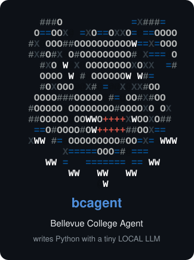

# bcagent — Bellevue College Agent (Capstone)

<p align="center">
  
</p>

<p align="center">
  <a href="https://github.com/PedroBSB/Bellevue-College-Agent-Capstone/actions/workflows/ci.yml"></a>
  <a href="https://github.com/PedroBSB/Bellevue-College-Agent-Capstone/releases/latest"></a>
  
</p>

**bcagent** is an AI coding assistant that lives in your terminal. You tell it in plain English what
you want, for example *"write a program that converts Celsius to Fahrenheit"*, and it writes the
Python code, shows you exactly what it wants to change, and saves the file **only after you say
yes**. It can also run your code, fix errors, run your tests, explain concepts, use git and GitHub,
and edit Google Colab and Jupyter notebooks.

Everything runs **on your own computer**: no account, no API key, no cloud, no cost. Your code
never leaves your machine unless you push it to GitHub yourself.

> New to AI assistants and "agents"? Start with [What is an AI agent?](#what-is-an-ai-agent). It
> needs no background knowledge.

---

## Contents

1. [What is an AI agent?](#what-is-an-ai-agent) – the ideas behind bcagent, in plain words
2. [Install](#install)
3. [Your first session (5 minutes)](#your-first-session-5-minutes)
4. [Talking to bcagent](#talking-to-bcagent) – prompts, `@files`, approving changes, shortcuts
5. [All commands, with examples](#all-commands-with-examples)
6. [Agents: what they are, choosing one, creating your own](#agents)
7. [MCP: giving the agent new tools](#mcp-giving-the-agent-new-tools)
8. [For students and instructors](#for-students-and-instructors), including [course profiles](#course-profiles-for-instructors)
9. [Data science: built-in libraries and notebooks](#data-science-built-in-libraries-and-notebooks)
10. [Git and GitHub](#git-and-github)
11. [Google Colab](#google-colab)
12. [Safety and privacy](#safety-and-privacy)
13. [Updates and going back to an older version](#updates)
14. [Settings](#settings)
15. [Troubleshooting](#troubleshooting)
16. [Development](#development)

---

## What is an AI agent?

**A language model (LLM)** is a program trained on a huge amount of text and code. Give it some
text (a *prompt*) and it continues it: answer a question, write a function, explain an error.
ChatGPT and Claude are large language models running in data centers. bcagent uses a *small* model
(about 400 MB) that runs on your laptop through a free program called **[Ollama](https://ollama.com)**.

**A chatbot** only talks. You copy its code into your files, run it, copy the error back, and
repeat.

**An agent** is a language model that can also *act*. It reads your project, writes the files,
runs the program, sees the error, and tries again, while you watch and approve each step. That
is what bcagent does:

```
   you: "add a function that averages a list in stats.py"
     │
     ▼
 ┌─────────────────────────────────────────────────────────────────────┐
 │ 1. bcagent collects context: your files, the folder, BCAGENT.md     │
 │ 2. the model (on your computer) writes an answer with the new code  │
 │ 3. bcagent turns it into an edit and shows you a colored diff       │
 │ 4. YOU decide: Yes / No / "Chat about this" (ask for something else)│
 │ 5. bcagent saves the file, checks it for syntax errors, offers to   │
 │    run it, and sends any error back to the model to fix             │
 └─────────────────────────────────────────────────────────────────────┘
```

A few more words you will see:

| Word | Meaning |
|------|---------|
| **Prompt** | What you type: your request or question. |
| **Model** | The trained AI "brain". Bigger models are smarter but slower and need more memory. bcagent's default is `qwen2.5-coder:0.5b` (0.5 billion parameters, ~400 MB). |
| **Ollama** | The free program that runs models on your computer. The installer sets it up. |
| **Context** | Everything the model sees for one request: your prompt, the relevant files, earlier messages. Small models have a small context, so they can't see huge files at once (bcagent protects you from that, see [Safety](#safety-and-privacy)). |
| **Agent** (in bcagent) | A model plus instructions plus a way of editing files, e.g. *bulldog* (writes code), *explainer* (only explains), *tester* (writes tests). You can switch agents or [make your own](#create-your-own-agent). |
| **Diff** | The before/after view of a change: green lines are added, red lines removed. |
| **MCP** | *Model Context Protocol*: a standard way to plug extra tools into an agent (web pages, a database, your own Python functions). See [MCP](#mcp-giving-the-agent-new-tools). |
| **Token** | A piece of a word. Models read and write tokens, and speed is measured in tokens per second. |

**What to expect from a small local model.** The default model is fast and great for short
programs, exercises, explanations and small fixes. It makes more mistakes than ChatGPT-class
models, so read the diff before you accept it. For harder work, install a bigger agent, such as
`bulldog-3b` (see [Agents](#agents)).

---

## Install

The installer sets up everything that is missing: **Python**, **Ollama**, **bcagent** itself, the
default **model**, and the default **data-science libraries** (numpy, pandas, scikit-learn,
statsmodels, statsformula). It needs no administrator rights.

| Your computer | Run this in a terminal |
|---------------|------------------------|
| **macOS / Linux** | `curl -fsSL https://raw.githubusercontent.com/PedroBSB/Bellevue-College-Agent-Capstone/main/install.sh \| bash` |
| **Windows** | open **PowerShell** and run `irm https://raw.githubusercontent.com/PedroBSB/Bellevue-College-Agent-Capstone/main/install.ps1 \| iex` |

Or download this repository and run `./install.sh` (macOS/Linux) or double-click `install.bat`
(Windows). When it finishes, **open a new terminal** and check it:

```bash
bcagent --version
bcagent doctor        # checks Python, Ollama, the model, git, GitHub sign-in and the libraries
```

<details>
<summary><b>What exactly the installer does, options, and uninstalling</b></summary>

| Step | macOS | Linux | Windows |
|------|-------|-------|---------|
| Python 3.10+ (if missing) | Homebrew, or the python.org `.pkg`; **no admin:** private Python in `~/.bcagent` | apt / dnf / yum / pacman / zypper / apk; **no sudo:** private Python in `~/.bcagent` | winget, or the python.org installer (per user); **blocked:** portable Python in `%USERPROFILE%\.bcagent\python` |
| bcagent + requirements (`rich`, `prompt_toolkit`) | venv in `~/.bcagent/venv` | same | `%USERPROFILE%\.bcagent\venv` |
| `bcagent` command | `~/.local/bin/bcagent` | same | `%USERPROFILE%\.bcagent\bin\bcagent.cmd` |
| Ollama (if missing) | Homebrew, or Ollama.app (`~/Applications` without admin) | `ollama.com/install.sh`; **no sudo:** `~/.bcagent/ollama` | winget or `OllamaSetup.exe`; **blocked:** portable `ollama.exe` |
| Default model | `ollama pull qwen2.5-coder:0.5b` (~400 MB) | same | same |
| Libraries for your code | numpy, pandas, scikit-learn, statsmodels, statsformula in `~/.bcagent/runenv` | same | same |

Options:

| Option | Effect |
|--------|--------|
| `--no-model` / `-NoModel` | don't download the model now (it downloads on first start) |
| `--no-packages` / `-NoPackages` | don't install the libraries now (installed on first start) |
| `--user` | never use `sudo`, even on an administrator account |
| `--uninstall` / `-Uninstall` (or `uninstall.sh` / `uninstall.bat`) | remove bcagent, keep settings, Ollama and models |
| `--uninstall-all` / `-UninstallAll` (add `--yes` / `-Yes` to skip the question) | remove **everything**: bcagent, settings, agents, MCP servers, models and Ollama (Python stays) |

**Lab or school computer without admin rights?** The installer notices and installs whatever is
missing for your user only: a private Python (via [uv](https://docs.astral.sh/uv/) or a prebuilt
[python-build-standalone](https://github.com/astral-sh/python-build-standalone)), and a private
Ollama.

</details>

**Requirements:** macOS 11+, Windows 10/11 or a modern Linux; about 2 GB of free disk space and
2 GB of RAM for the default agent (bigger agents need more, see the [catalog](#the-agent-catalog)).

---

## Your first session (5 minutes)

Make a folder for practice and start bcagent in it. bcagent only ever reads and writes files
**inside the folder you start it in**.

```bash
mkdir hello-bulldogs
cd hello-bulldogs
bcagent
```

You see the Bulldog welcome screen and a `>` prompt. Try these one at a time:

**1. Ask for a program.**

```
> create temps.py that converts a temperature from Celsius to Fahrenheit, asking the user for the number
```

bcagent thinks for a moment, then shows the new file as a green diff and asks:

```
Do you want to create temps.py?
❯ 1. Yes
  2. Yes, and don't ask again this session (shift+tab)
  3. No
  4. Chat about this
```

Use the **↑/↓ arrows** and **Enter**, or press **1**. bcagent saves the file and offers to run it:
`Run this command?  python temps.py` → **Yes**. Type a number when the program asks.

**2. Change it.** Mention a file with `@` (press Tab to complete the name):

```
> make @temps.py also convert Fahrenheit to Celsius, with a menu to choose
```

**3. Ask a question.** Not every request has to change files:

```
> explain what the if __name__ == "__main__" line in @temps.py does
```

**4. Undo, save your work and leave.**

```
> /undo                      # puts temps.py back the way it was before the last change
> /git init                  # (optional) start version control
> commit my changes          # plain English works for common actions
> exit
```

Tomorrow, `bcagent -c` in the same folder **continues the conversation** where you left off.

---

## Talking to bcagent

**Write requests like you would to a classmate:** say what you want, which file, and anything
important. Good prompts:

```
create a tic-tac-toe game in tictactoe.py for two players in the terminal
add input validation to @calc.py so it rejects letters
why does @grades.py print None at the end?
write pytest tests for @utils.py
read data.csv with pandas and plot the average score per week, save the plot as weekly.png
```

| You type | What happens |
|----------|--------------|
| any text | a request for the agent (or a [built-in action](#plain-language-actions), e.g. *commit and push*) |
| `@file.py` or `@folder/` | includes that file (or all files of a folder) in the context; **Tab** completes names |
| `!command` | runs a shell command, e.g. `!ls` or `!python temps.py`; the output is shared with the agent |
| `/command` | a bcagent command, e.g. `/help` (see [all commands](#all-commands-with-examples)) |
| `?` | quick help |

**When bcagent asks you something** (save this file? run this command?), choose with **↑/↓** and
**Enter**, press the option's **number**, `y`, `n`, or **Esc** for no. **Chat about this** lets you
type a reply instead: *"use a while loop instead"* or *"why do you want to change line 12?"*.

**Keyboard shortcuts**

| Keys | Action |
|------|--------|
| `shift+tab` | auto-accept edits on/off (bcagent stops asking before saving files) |
| `esc` then `enter` | new line in your prompt |
| `ctrl+c` while bcagent is answering | stop the answer |
| `ctrl+c` / `ctrl+d` at the prompt, or `exit` | leave bcagent |
| `↑` / `↓` at the prompt | earlier prompts |

**What happens after an edit:** bcagent checks every Python file it writes for syntax errors and
asks the model to fix them (up to 2 times). It offers to run scripts it wrote. Your code runs with
the project's own `.venv` if there is one, otherwise with bcagent's private environment, which
already has the [data-science libraries](#data-science-built-in-libraries-and-notebooks). If the
program crashes, bcagent offers to send the error to the agent to fix. If the error is
*No module named X*, it offers to `pip install` it.

### Plain-language actions

Even with the tiny default model, bcagent recognizes common requests and does them itself
(it always asks first):

| You say | bcagent runs |
|---------|--------------|
| *commit my changes*, *commit and push* | `/git commit` → `/git push` |
| *pull the latest changes from github* | `/git pull` |
| *what changed?* | `/git` (status) |
| *undo the last commit* | `/git revert` |
| *create a github repo for this project*, *put this on github* | `/github create` |
| *open a pull request* | `/github pr` |
| *set up an ssh key*, *sign in to github* | `/github ssh`, `/github login` |
| *run the tests* | `/test` |
| *review my code* | `/review` |
| *save it to colab* | `/colab push` |

Mixed requests such as *"fix the bug in calc.py and commit"* go to the agent first, then bcagent
offers the commit. Questions (*"how do I push to GitHub?"*) always go to the agent, which explains.

---

## All commands, with examples

### Inside a session

| Command | What it does | Example |
|---------|--------------|---------|
| `/help` | all commands and shortcuts | `/help` |
| `/undo` | undo the last set of file changes | `/undo` |
| `/run [file.py] [args]` | run a Python file (default: the last one bcagent wrote) | `/run temps.py` |
| `/test [pytest args]` | run the tests; on failures offer a fix and run again | `/test -k average` |
| `/review [@file …]` | instructor-style feedback, without rewriting your code | `/review @grades.py` |
| `/learn [on\|off]` | learning mode: hints and explanations instead of finished code | `/learn` |
| `/export [file.md]` | save a readable log of this session | `/export lab3-log.md` |
| `/resume` | continue an earlier conversation in this folder | `/resume` |
| `/add <file>` / `/drop <file\|all>` / `/files` | always include a file in the context / stop / list | `/add data.csv` |
| `/init` | create `BCAGENT.md`, notes the agent reads with every prompt | `/init` |
| `/agents` / `/agents catalog` | installed agents / agents you can install | `/agents catalog` |
| `/agent <name>` | switch agent | `/agent explainer` |
| `/install <name\|model\|file.md\|url>` | install an agent | `/install bulldog-3b` |
| `/model <ollama-tag>` | use another model for this session | `/model qwen2.5-coder:1.5b` |
| `/mcp …` | MCP servers: `list`, `catalog`, `add`, `remove`, `tools` | `/mcp add fetch` |
| `/git …` | git: status, diff, commit, push, pull, branch, revert … | `/git commit` |
| `/github …` | GitHub: login, ssh, create, pr, prs, open | `/github create` |
| `/colab …` | Google Colab notebooks: link, pull, push, open … | `/colab <url>` |
| `/packages` | check / install the default libraries | `/packages` |
| `/course` | show the course profile your instructor set | `/course` |
| `/bug [what happened]` | report a problem with bcagent on GitHub | `/bug the diff colors are wrong` |
| `/auto` | auto-accept edits on/off (same as shift+tab) | `/auto` |
| `/clear` | forget the conversation (start fresh) | `/clear` |
| `/status`, `/doctor` | current agent and model / check the installation | `/doctor` |
| `/update [--to <version> \| --list]` | update or roll back bcagent, then restart | `/update` |
| `/exit` | leave (also `exit`, `quit`, ctrl+d) | `/exit` |

### From the terminal

| Command | What it does |
|---------|--------------|
| `bcagent` | start a session in the current folder |
| `bcagent "create a todo app in todo.py"` | start a session with a first request |
| `bcagent -p "write fizzbuzz in fizz.py" --yes` | one-shot: do the request, print the answer, exit (`-y`/`--yes` saves edits without asking) |
| `bcagent -c` / `bcagent -r` | continue the last conversation / pick an earlier one |
| `bcagent --learn` | start in learning mode |
| `bcagent -a tester "write tests for @calc.py"` | use a specific agent (install it first: `bcagent agents install tester`) |
| `bcagent -m qwen2.5-coder:1.5b` | use any Ollama model for this run |
| `bcagent -C ~/projects/lab3` | work on another folder |
| `bcagent --colab <url> "add a cell that plots x"` | link a Colab notebook and edit it |
| `bcagent agents list\|catalog\|install\|create\|use\|remove` | manage [agents](#agents) |
| `bcagent mcp list\|catalog\|add\|remove\|tools` | manage [MCP servers](#mcp-giving-the-agent-new-tools) |
| `bcagent git <command>` / `bcagent github <command>` | [git and GitHub](#git-and-github) without a session |
| `bcagent colab login\|list\|link\|pull\|push` | [Colab](#google-colab) without a session |
| `bcagent packages [list]` | check / install the default libraries |
| `bcagent agents recommend` | the best agent for this computer's memory |
| `bcagent course show\|create\|install <file\|url>\|remove` | [course profiles](#course-profiles-for-instructors) for instructors |
| `bcagent doctor` | check the installation |
| `bcagent update [--to X.Y.Z \| --list]` | update or roll back |
| `bcagent bug "what went wrong"` | report a problem |
| `bcagent --version`, `bcagent --help` | |

---

## Agents

### What is an agent in bcagent?

Think of an agent as **a role you hire for a job**. Each agent is three things:

1. **A model**, the AI brain that runs on your computer (small and fast, or bigger and smarter).
2. **Instructions**, a short "job description" the model reads before every request, e.g.
   *"You write pytest unit tests"* or *"Explain code for a college student; never edit files"*.
3. **An edit format**, how it changes files:
   - `whole`: writes the complete file every time. Most reliable for tiny models (the default).
   - `diff`: writes only the lines to change, as SEARCH/REPLACE blocks. Better for bigger models
     and big files.
   - `none`: only talks, never edits files.

The default agent is **bulldog** (`qwen2.5-coder:0.5b`, `whole`): a fast general Python coder.

### The agent catalog

```bash
bcagent agents catalog
```

| Agent | Model | Size | Good for |
|-------|-------|------|----------|
| `bulldog` (default, installed) | Qwen2.5-Coder 0.5B | ~400 MB | fast; short programs, exercises, explanations |
| `bulldog-1.5b` | Qwen2.5-Coder 1.5B | ~1 GB | smarter, still fast |
| `bulldog-3b` | Qwen2.5-Coder 3B (`diff` edits) | ~1.9 GB | good quality, targeted edits of bigger files, MCP tools |
| `bulldog-7b` | Qwen2.5-Coder 7B (`diff` edits) | ~4.7 GB | best quality; needs 8+ GB RAM |
| `deepseek-1.3b`, `yi-coder-1.5b`, `granite-3b` | other small code models | 0.8–2 GB | alternatives to compare |
| `tester` | 0.5B | – | writes pytest tests in `tests/test_<module>.py` |
| `explainer` | 0.5B (`none`) | – | explains code and answers questions, never edits |
| `docs` | 0.5B | – | adds docstrings, type hints and READMEs without changing behavior |

### Using agents

```bash
bcagent agents install bulldog-3b       # download it (once); the model is pulled automatically
bcagent -a bulldog-3b                   # use it for one session
bcagent agents use bulldog-3b           # make it your default
```

Inside a session: `/agents` lists them, `/agent explainer` switches, and `/install tester`
installs one. Example of using two agents in a row:

```
> /install tester
> /agent tester
> write tests for @stats.py
> /agent bulldog
> /test
```

**Which one should I use?** bcagent can tell you: `bcagent agents recommend` looks at your
computer's memory and suggests the best agent it can run comfortably. On first start it also offers
the recommended agent once. It never switches without asking.

| Memory (RAM) | Suggested agent |
|--------------|-----------------|
| under 6 GB | `bulldog` (0.5B) |
| 6–12 GB | `bulldog-1.5b` |
| 12–24 GB | `bulldog-3b` |
| 24 GB or more | `bulldog-7b` |

Use `explainer` when you want to understand, not change, code.

Any model on [ollama.com/library](https://ollama.com/library) works too:

```bash
bcagent agents install codellama:7b --name llama --prompt "You write very short code" --format diff
bcagent -m llama3.2:3b                  # or just try a model for one session
```

### Create your own agent

An agent is a small text file. Create a template and edit it:

```bash
bcagent agents create statsdog          # writes ~/.bcagent/agents/statsdog.md
```

**Example 1: a statistics tutor** that uses the built-in libraries and explains every step:

```markdown
---
name: statsdog
description: Statistics helper for data-analysis homework
model: qwen2.5-coder:1.5b
edit_format: whole        # whole (full files) | diff (SEARCH/REPLACE) | none (chat only)
temperature: 0.2          # 0 = predictable, 1 = creative
---
You help students with statistics in Python.
- Use pandas for data and statsmodels formulas (smf.ols("y ~ x", data=df)) for regression.
- Use statsformula (sf.dmatrices) when the student writes R-style formulas.
- After the code, explain in 3 short bullet points what the output means.
- Always print the model summary and check for missing values first.
```

Then: `bcagent -a statsdog "regress score on hours_studied in grades.csv"`. This file is also in
[`examples/statsdog.md`](examples/statsdog.md): `bcagent agents install examples/statsdog.md`.

**Example 2: a Flask web-app builder:**

```markdown
---
name: flaskdog
description: Builds small Flask web apps
model: qwen2.5-coder:1.5b
edit_format: whole
---
You build Flask web apps. Always include a requirements.txt and a templates/ folder.
Keep each file short and add comments for beginners.
```

**Share an agent with your class or team:** put the file in your project as
`.bcagent/agents/<name>.md` and commit it. Everyone who runs bcagent in that project gets the
agent. You can also install one from a file or a link:

```bash
bcagent agents install ./statsdog.md
bcagent agents install https://example.com/agents/statsdog.md
bcagent agents remove llama --delete-model      # remove an agent (and its model)
```

**Project notes for any agent:** `/init` creates a `BCAGENT.md` file in your project. Write your
rules there (*"use type hints"*, *"tests go in tests/"*, *"this project analyzes NOAA weather
data"*). It is sent with every prompt, just like `CLAUDE.md` for Claude Code.

---

## MCP: giving the agent new tools

### What is MCP?

On its own, the model can only read the files bcagent shows it and write text. **MCP (Model
Context Protocol)** is an open standard, a bit like **USB for AI tools**: any program that "speaks
MCP" (an **MCP server**) can offer *tools* to any agent that supports it. With MCP, the agent can
fetch a web page, check the time, remember facts between sessions, query a database, or call
functions you write yourself.

How it works in bcagent:

1. You add a server once: `bcagent mcp add fetch`.
2. When a session starts, bcagent starts the server and tells the model which tools exist.
3. When the model needs a tool, it asks for it. bcagent shows you the call and **asks for your
   approval**, then gives the result back to the model, which continues.

```
> what's on the front page of https://example.com? summarize it
● fetch.fetch({"url": "https://example.com"})
Allow MCP tool fetch.fetch?
❯ 1. Yes
  2. Yes, and don't ask again for fetch.fetch this session
  3. No
  ⎿  Example Domain · This domain is for use in illustrative examples …
● The page is a placeholder that says the domain is reserved for examples …
```

> **Tip:** tools need a model that's good at following instructions. The tiny default model
> often ignores tools or makes up an answer. For MCP, use `bulldog-3b` or bigger
> (`bcagent -a bulldog-3b`).

### Installing MCP servers

```bash
bcagent mcp catalog                 # ready-made public servers
bcagent mcp add fetch               # add one
bcagent mcp list                    # what you have
bcagent mcp tools                   # start them and list their tools
bcagent mcp remove fetch
```

| Server | What it gives the agent | Needs |
|--------|-------------------------|-------|
| `fetch` | read web pages (as markdown) | [uv](https://docs.astral.sh/uv/) |
| `time` | current time, time-zone conversion | uv |
| `git` | git status, diff, log, commit | uv |
| `filesystem` | read, write and search files in the project | [Node.js](https://nodejs.org) |
| `memory` | a memory that persists between sessions | Node.js |
| `sequential-thinking` | a step-by-step problem-solving tool | Node.js |
| `everything` | a test server that exercises every MCP feature | Node.js |

Thousands of other servers exist (search for "MCP server" plus a topic). Add them by package name or
command:

```bash
bcagent mcp add @modelcontextprotocol/server-memory          # any npm package (runs with npx)
bcagent mcp add pypi:mcp-server-time                          # any PyPI package (runs with uvx)
bcagent mcp add weather -e API_KEY=abc123 -- python weather_server.py   # any command, with a secret
bcagent mcp add git --project                                 # save in ./.mcp.json to share with the repo
```

Inside a session the same commands start with `/mcp`, e.g. `/mcp add fetch`. Your servers are in
`~/.bcagent/mcp.json`. Project servers are in `./.mcp.json`, which you can commit so classmates get
them too. The format is the same `mcpServers` format Claude Code and Claude Desktop use.

### Write your own MCP server (10 lines of Python)

A server is a Python file with functions marked as tools. The function's docstring tells the
model what the tool does. Install the official library once with `pip install mcp`, then save this
as `grades_server.py`:

```python
"""A tiny MCP server: gives the agent a tool to look up course grades."""
from mcp.server import MCPServer      # mcp 2.x  (for mcp 1.x: from mcp.server.fastmcp import FastMCP)

mcp = MCPServer("grades")

GRADES = {"alice": 93, "bob": 78, "chen": 88}


@mcp.tool()
def get_grade(student: str) -> str:
    """Return the course grade (0-100) of a student by first name."""
    grade = GRADES.get(student.lower())
    return f"{student}: {grade}" if grade is not None else f"no student named {student}"


if __name__ == "__main__":
    mcp.run()
```

Add it and use it (the file is also in [`examples/grades_server.py`](examples/grades_server.py)):

```bash
bcagent mcp add grades -- python grades_server.py
bcagent mcp tools                     # → grades.get_grade  Return the course grade (0-100) …
bcagent -a bulldog-3b "What is Bob's grade? Use the grades tool."
```

```
● grades.get_grade({"student": "Bob"})       ← bcagent asks before running it
● Bob's grade is 78.
```

Ideas for your own servers: look up a class schedule, query a SQLite database, call a weather
API, read sensor data, or search your notes.

---

## For students and instructors

| Command | What it does |
|---------|--------------|
| `/learn` or `bcagent --learn` | **Learning mode.** bcagent explains concepts, points to the line with the problem, gives the next step as a hint and asks a guiding question. It does **not** write the solution and never edits files. Instructors can turn it on for a whole lab with `"learn_mode": true` in the config or `BCAGENT_LEARN=1`. |
| `/review [@file …]` | **Code review** like an instructor's: what works well, bugs (file and line), style (PEP 8, names, docstrings), what to test, one next step. It doesn't rewrite anything. With no file, it reviews your uncommitted Python files. |
| `/test` | Runs **pytest**. If tests fail, it offers to let the agent fix **your code**. It never changes the tests to make them pass. Then it runs them again, up to 3 rounds. It installs pytest if needed and offers to write tests if there are none. |
| `/export [file.md]` | Saves a **session log**: every prompt, answer, applied edit (with diff) and command with its result. Students can hand it in with an assignment to show how they used AI. |
| `/resume`, `bcagent -c` | Continue an earlier conversation in this folder (the last 10 are kept). |
| `/course` | Shows the rules your instructor set in a [course profile](#course-profiles-for-instructors). |

Example, learning mode:

```
> /learn
✓ learning mode on: bcagent explains and gives hints but doesn't write the solution or edit files.
> my @average.py crashes with ZeroDivisionError
● The crash happens on line 4, where you divide by len(numbers). When is that zero?
  Hint: check what the function should return for an empty list before dividing.
  Question: what does your program do if the user enters no numbers at all?
```

### Course profiles (for instructors)

A **course profile** is one small text file in which an instructor decides how bcagent behaves for
a class. You don't need to know anything about AI models to write one. With a profile you can:

- turn **learning mode** on (hints instead of solutions) and **lock** it, so students can't turn
  it off;
- set an **exam window** during which bcagent gives **no AI help at all**, or only explains error
  messages and Python concepts;
- choose **which agents** students may use (and block other models);
- turn **MCP tools** (web pages and other outside tools) on or off;
- **save a log of every session automatically**, which students hand in with their work;
- give the agent **notes about your course or assignment**, e.g. *"students haven't learned
  classes yet, don't use them"*.

#### Step 1: create the profile

In the folder with your assignment's starter files, run:

```bash
bcagent course create        # writes .bcagent/course.md with every setting explained
```

Open `.bcagent/course.md` in any text editor. The part between the `---` lines holds the
settings, and everything below them is the notes for the agent:

```markdown
---
course: CS 110 – Introduction to Python
instructor: Prof. Rivera
learn_mode: locked
allowed_agents: bulldog, explainer, tester
default_agent: bulldog
allow_mcp: false
session_log: auto
exam_start: 2026-12-10 09:00
exam_end: 2026-12-10 11:00
exam_mode: blocked
---
This is an introductory course. Use only loops, lists, dictionaries and functions.
Students have not learned classes or list comprehensions yet: don't use them.
Explain like you would to a first-year student.
```

| Setting | Values | What it does |
|---------|--------|--------------|
| `course`, `instructor` | any text | shown on the welcome screen, in `/course` and in every session log |
| `learn_mode` | `off` · `on` · `locked` | `on`: sessions start in [learning mode](#for-students-and-instructors) (hints, no edits), and students may turn it off with `/learn`. `locked`: always on. `off`: normal bcagent |
| `allowed_agents` | comma-separated names | the only agents students may use. `-m`, `/model` and other agents are refused. Empty = any agent |
| `default_agent` | an agent name | the agent sessions start with (installed automatically if it is in the catalog) |
| `allow_mcp` | `true` · `false` | `false` turns MCP servers off, so there's no web access through tools |
| `session_log` | `auto` · `off` | `auto`: when bcagent exits, a log of the session is saved in `bcagent-logs/` |
| `exam_start`, `exam_end` | `YYYY-MM-DD HH:MM` (local time) | the exam window. Empty = no exam |
| `exam_mode` | `blocked` · `hints` | during the window, `blocked` means no AI help at all, and `hints` means it only explains error messages and Python concepts, without code for the task. git, `/run` and `/test` keep working |
| notes (below the `---`) | free text | sent to the agent with every request (up to ~3000 characters) |

Check the result with `bcagent course show` or `/course`:

```
course          CS 110 – Introduction to Python  · Prof. Rivera
learning mode   locked on
agents          bulldog, explainer, tester
MCP tools       turned off
session log     saved automatically in bcagent-logs/
exam            Dec 10 09:00 – 11:00 (upcoming) · no AI help
profile         ~/cs110/lab3/.bcagent/course.md · fingerprint 3f9a1c0b7e2d
```

#### Step 2: give it to your students

- **With the assignment (recommended):** keep `.bcagent/course.md` in the assignment's starter
  repository, zip file or GitHub Classroom template. Every student who runs bcagent in that folder
  gets the rules, and different assignments can have different profiles.
- **On lab computers:** `bcagent course install course.md` (or a link:
  `bcagent course install https://…/course.md`) installs the profile for *every* folder on that
  computer, in `~/.bcagent/course.md`. A project's own profile wins over it.
  `bcagent course remove` uninstalls it.

#### What students see

The welcome screen shows the course (`course: CS 110 – Introduction to Python · learning mode
(locked)`). Requests that the profile doesn't allow are refused politely. For example, during an
exam with `exam_mode: blocked`:

```
> fix my code
✋ AI help is turned off during the exam (until 11:00, set by your instructor in the course profile).
  git, /run and /test still work.
```

Other refusals: `/learn off` with a locked learning mode, `/agent bulldog-7b` or `/model …` when
only some agents are allowed, and `/mcp add …` with `allow_mcp: false`.

#### Step 3: collect session logs

With `session_log: auto`, every session ends with
`Session log saved to bcagent-logs/bcagent-session-20261113-142233.md`. Ask students to submit that
folder with their work, for example by committing it (`commit my changes` does that) or by
uploading it to your learning management system. Each log lists every prompt, every answer, every
edit with its diff, and every command with its result. It also records the course name and the
profile's **fingerprint**, a short code that changes whenever the profile file changes. If the
fingerprint in a student's log isn't the one `bcagent course show` prints for your file, the
student used a different or edited profile.

> **Honest limits:** a course profile *guides* students; it isn't proctoring software. A student who
> deletes the file, or uses another AI tool, isn't stopped. Treat it like a class policy that the
> tool helps students follow and that the logs make visible.

Ready-made profiles in [`examples/`](examples/): an intro course (hints instead of answers), an exam
day (AI off for two hours), and a statistics course with its own agent.

---

## Data science: built-in libraries and notebooks

Code that bcagent runs can always use **numpy, pandas, scikit-learn, statsmodels and
[statsformula](https://github.com/PedroBSB/statsformula)** (R-style formulas for Python). The agent
knows they are installed, so requests like these just work:

```
> read sales.csv with pandas and print the average revenue per month
> fit a linear regression of price on size and rooms with statsmodels and print the summary
> use statsformula to build the design matrix for "y ~ x + C(region)" and fit it with scikit-learn
> split iris into train and test and compare a decision tree with logistic regression
```

statsformula in one line: `import statsformula as sf; y, X = sf.dmatrices("y ~ x + C(group)", df)`.

bcagent checks the libraries every time it starts. It's a fast check that needs no internet, and
bcagent installs whatever is missing. `bcagent packages` does it by hand. Change the list with
`"default_packages"` in the [settings](#settings).

**Jupyter notebooks (`.ipynb`).** bcagent can edit notebooks in your project. It shows them to the
agent as Python, where every cell starts with `# %%` and text cells with `# %% [markdown]`, and
saves them back as real notebooks. Cells you didn't change keep their outputs, `/undo` restores the
exact original file, and bcagent warns if an edit would delete code cells.

```
> add a cell to @lab2.ipynb that plots the histogram of the age column
```

---

## Git and GitHub

**Git** keeps the history of your project, like unlimited undo that you control with *commits*
(snapshots). **GitHub** stores that history online so you can share it, back it up and hand in
assignments. bcagent has both built in. Every command runs the real `git` and explains errors in
plain words, and it always asks before anything that changes GitHub or throws work away.

**A typical flow:**

```
> /git init                 start a repository here (adds a Python .gitignore)
> /git commit               commit all changes; bcagent writes the message, you approve or edit it
> /github create            create a private GitHub repository for this folder and upload it
> /git branch add-tests     start a branch, make changes with bcagent as usual…
> /git commit
> /github pr                upload the branch and open a pull request
```

| Command | What it does |
|---------|--------------|
| `/git` | status: branch, changed files, commits to push or pull |
| `/git init` · `/git clone <url\|owner/repo>` | start a repository · copy one from GitHub |
| `/git diff [file]` · `/git log` | what changed · recent commits |
| `/git commit [message]` | commit everything; without a message the local model writes one |
| `/git push [--force]` · `/git pull` | upload / download commits (shows what will be pushed and asks) |
| `/git branch [name]` · `/git switch <branch>` · `/git merge <branch>` | branches |
| `/git revert [commit]` | undo a commit with a new commit (safe even after pushing) |
| `/git uncommit` | undo the last commit but keep the changes (only if not pushed yet) |
| `/git discard <file\|all>` · `/git stash [pop]` · `/git remote [url]` | throw away changes · park them · set the GitHub address |
| `/git <anything else>` | runs that git command, e.g. `/git tag v1.0` |
| `/github login` · `/github logout` · `/github status` | sign in to GitHub |
| `/github ssh` | set up an SSH key for `git@github.com` addresses (guided) |
| `/github create [name] [--public]` | create a GitHub repository for this folder and push it (private unless `--public`) |
| `/github pr [title]` · `/github prs` · `/github open` | open a pull request · list them · open the repo in the browser |

The same commands work outside a session (`bcagent git commit`, `bcagent github create`). bcagent
won't commit files that look like secrets (`.env`, keys, `client_secret*.json`) unless you confirm.
The first time you commit, it asks for your name and email and can suggest your private GitHub
*noreply* address.

**Signing in to GitHub** happens the first time you need it (or with `/github login`). bcagent walks
you through one of these options:

- **GitHub CLI** (if [`gh`](https://cli.github.com) is installed): sign in with your browser. If you
  already use `gh`, bcagent uses that sign-in automatically.
- **Personal access token**: bcagent opens a GitHub page that already fills in the name and the
  permissions (`repo`, `workflow`, `write:public_key`). Pick an expiration, click *Generate token*
  and paste it (input is hidden).
- **SSH key** (for `git@github.com:…` addresses): `/github ssh` checks `~/.ssh` and offers to reuse a
  key or create one. It adds GitHub's official host keys, then uploads your public key, either
  automatically or by copying it and opening GitHub's *New SSH key* page with steps. It finishes by
  testing the connection. If a push or pull fails because SSH isn't set up, bcagent offers this
  setup, or switches the repository to HTTPS, and tries again.

`GH_TOKEN` / `GITHUB_TOKEN` also work. The token is stored only in `~/.bcagent/github/token.json`
(readable only by you) and is never written into `.git/config` or shown in a command.

---

## Google Colab

bcagent can edit your [Google Colab](https://colab.research.google.com) notebooks. Paste the link:

```
> /colab https://colab.research.google.com/drive/1AbC…xyz
✓ linked Week 3 Lab.ipynb (12 cells) → colab/week_3_lab.py
> add a cell that loads data.csv with pandas and plots the first column
  ⎿  Saved to Colab: Week 3 Lab.ipynb (reload the Colab tab to see it)
```

bcagent downloads the notebook into `colab/<name>.py` (one `# %%` line per cell). You ask for changes
and approve them as usual, and bcagent uploads each approved change to Colab. Unchanged cells keep
their outputs. **Reload the Colab tab** to see the changes, and don't edit the same notebook in
Colab at the same time. If the notebook changed in Colab meanwhile, bcagent asks before
overwriting (`/colab pull` gets the Colab version).

| Command | What it does |
|---------|--------------|
| `/colab <url>` | link a notebook (also `bcagent --colab <url> "request"`) |
| `/colab pull` · `/colab push [--force]` | download from / upload to Colab |
| `/colab open` · `/colab list` · `/colab unlink` | open in the browser · linked notebooks · stop syncing |
| `/colab login` · `/colab logout` | sign in to / out of Google |

**Signing in to Google.** The first `/colab` walks you through it:

- **Permanent** (recommended, about 5 minutes once): create a free Google Cloud project with the
  Drive API and a *Desktop app* OAuth client, and give bcagent the downloaded
  `client_secret_….json`. bcagent opens the browser to sign in and renews access by itself. Google
  shows *"Google hasn't verified this app"* because the app is your own: click **Continue**.
- **Quick** (1 minute, lasts 1 hour): get an access token from the
  [OAuth 2.0 Playground](https://developers.google.com/oauthplayground) with the scope
  `https://www.googleapis.com/auth/drive` and paste it.

Credentials stay on your computer in `~/.bcagent/google/`. For a notebook on GitHub, or one you can
only view, choose **File ▸ Save a copy in Drive** in Colab and link the copy.

---

## Safety and privacy

- **Your code stays on your computer.** The model runs locally through Ollama. bcagent connects to
  the internet only for things you ask for: downloading models and libraries, checking for updates,
  GitHub, Google Colab, MCP servers that fetch web pages, and bug reports you choose to send.
- **You approve every change** to your files and every command (unless you turn on auto-accept).
  `/undo` reverts the last change, and bcagent never writes outside the folder you started it in.
- **Big files are edited one function at a time.** Small models can't see a long file all at once.
  When your request names a function or class (*"fix load_data in @big.py"*), bcagent shows the
  model only that part, and the model sends back just the new version. bcagent then puts it into
  the full file, so everything else stays exactly as it was. If the agent ever tries to rewrite a
  long file it saw only partly, which would delete the rest, bcagent refuses.
- **Tests stay honest.** While fixing failing tests, bcagent doesn't let the model edit the test
  files.
- **Secrets stay private.** Secret-looking files aren't committed without your confirmation, and
  tokens are stored only in `~/.bcagent` (readable only by you).

### Reporting bugs

If something goes wrong inside bcagent, it keeps running and asks whether you want to report it.
You see the complete report before anything is sent. Your home folder is replaced with `~`,
tokens, keys and email addresses are removed, and your prompt is included only if you say yes.
With a GitHub sign-in the report becomes an
[issue](https://github.com/PedroBSB/Bellevue-College-Agent-Capstone/issues) from your account. If
the same problem is already reported, it becomes a comment there instead. Without a sign-in,
bcagent opens a pre-filled issue page in your browser. Report something yourself with
`/bug what happened` or `bcagent bug "…"`. Choose *don't ask again* to stop the question.

---

## Updates

New installs and updates both use the latest **release**, never untested code. bcagent updates
itself: when it starts, it checks the latest
[release](https://github.com/PedroBSB/Bellevue-College-Agent-Capstone/releases) (at most every 6 hours,
3-second limit, so being offline doesn't slow it down). When a newer one exists, it upgrades and
restarts. Every release must first pass the automated tests on macOS, Linux and Windows.

```bash
bcagent update                  # check and update now (also /update in a session)
bcagent update --list           # all releases
bcagent update --to 1.5.0       # go back to an older version (pauses automatic updates)
bcagent update                  # return to the latest and resume automatic updates
```

Turn automatic updates off with `"auto_update": false` in the settings or `BCAGENT_NO_UPDATE=1`.

---

## Settings

Settings live in `~/.bcagent/config.json` (on Windows `%USERPROFILE%\.bcagent\config.json`):

| Setting | Default | Meaning |
|---------|---------|---------|
| `agent` | `"bulldog"` | default agent |
| `num_ctx` | `8192` | context size in tokens: how much the model can see at once (bigger = more memory) |
| `max_tokens` | `4096` | longest answer |
| `max_repairs` | `2` | automatic fix attempts after a syntax error |
| `ollama_host` | `null` | Ollama address (default `http://127.0.0.1:11434`) |
| `default_packages` | numpy, pandas, scikit-learn, statsmodels, statsformula | libraries for your code (`[]` = none) |
| `learn_mode` | `false` | start every session in learning mode |
| `bug_reports` | `true` | offer to report internal errors |
| `auto_update` | `true` | update automatically |
| `pinned_version` | – | set by `bcagent update --to`; pauses automatic updates |
| `recommend_asked` | – | set once bcagent has suggested an agent for your computer |

| Environment variable | Effect |
|----------------------|--------|
| `BCAGENT_HOME` | move `~/.bcagent` somewhere else |
| `BCAGENT_LEARN=1` | learning mode on |
| `BCAGENT_NO_UPDATE=1` · `BCAGENT_NO_PACKAGES=1` | skip the update check · skip the library check |
| `GH_TOKEN` / `GITHUB_TOKEN` · `BCAGENT_GOOGLE_TOKEN` | GitHub · Google access token |
| `OLLAMA_HOST` | Ollama address |

---

## Troubleshooting

| Problem | Try |
|---------|-----|
| `bcagent: command not found` | open a **new** terminal (the installer added it to your PATH), or run `~/.local/bin/bcagent` |
| "Ollama is not running" | start the Ollama app (or run `ollama serve`), then `bcagent doctor` |
| answers are wrong or ignore your file | mention the file with `@file.py`; keep requests small; try `bcagent -a bulldog-3b` |
| "Not applied … the file is too long" | name the function or class you want changed (*"fix load_data in @big.py"*); bcagent then edits just that part |
| "No module named …" when running code | accept bcagent's offer to install it, or run `bcagent packages` |
| the agent doesn't use MCP tools | use a bigger agent (`bulldog-3b`+) and say *"use the … tool"* |
| push fails with "Permission denied (publickey)" | `/github ssh` (or switch to HTTPS when bcagent offers) |
| "pytest failed to start" | your Python has a broken pytest plugin; create a project venv: `python -m venv .venv`, then `.venv/bin/pip install pytest` |
| anything else | `bcagent doctor`, then `/bug what happened` |

---

## Development

```bash
git clone https://github.com/PedroBSB/Bellevue-College-Agent-Capstone.git && cd Bellevue-College-Agent-Capstone
python -m venv .venv && .venv/bin/pip install -e . pytest
.venv/bin/python -m pytest -q tests     # ~85 tests, offline; never touches your accounts or ~/.ssh
```

CI runs two workflows. `tests` runs the test suite on macOS, Linux and Windows. `installers` runs
the real installers on fresh macOS, Ubuntu and Windows machines, and in a bare Ubuntu container with
no Python and a student account without admin rights. That second workflow also runs every Monday
to catch changes in Ollama, Python or PyPI.

**Releasing:** bump the version in `bcagent/__init__.py` and `pyproject.toml`, commit, then
`git tag v1.7.0 && git push origin main v1.7.0`. The `release` workflow runs the tests on macOS,
Linux and Windows, checks that the tag matches the version, and publishes the GitHub release.
Installed copies update only after that.

```
bcagent/
├── install.sh / install.ps1 / install.bat    installers (macOS+Linux / Windows)
├── uninstall.sh / uninstall.bat
├── pyproject.toml
├── examples/                                 course profiles, a custom agent and an MCP server to copy
├── tests/                                    pytest suite (CI on macOS, Linux and Windows)
├── .github/workflows/                        ci.yml (tests) · installers.yml · release.yml (tag vX.Y.Z → tested release)
└── bcagent/
    ├── cli.py        command line, interactive prompt, slash commands, subcommands
    ├── session.py    the agent loop: prompt → model → edits → approval → check → repair; /test /review /export
    ├── edits.py      turns the model's answer into file edits and shell commands
    ├── project.py    file tree, BCAGENT.md notes, picking relevant files, notebook view
    ├── sections.py   big files: show only the named functions, splice the model's new versions back
    ├── course.py     course profiles for instructors (learning mode lock, exams, allowed agents, logs)
    ├── hardware.py   memory detection and the recommended agent
    ├── agents.py     built-in agent, catalog, installing and creating agents
    ├── actions.py    plain-language requests → built-in actions (commit, push, tests, colab…)
    ├── mcp.py        MCP client, public server catalog, ~/.bcagent/mcp.json
    ├── git.py        /git and /github: git commands, GitHub and SSH sign-in, repos, pull requests
    ├── colab.py      Google Colab: Google sign-in, Drive API, notebook ↔ `# %%` sync
    ├── packages.py   default libraries for your code
    ├── report.py     bug reports to GitHub issues (scrubbed, previewed, from your account)
    ├── llm.py        Ollama client (standard library only, streaming)
    ├── ui.py         Bellevue College Blue theme, Bulldog banner, diffs, menus
    ├── update.py     self-update from GitHub releases, rollback, version pinning
    └── config.py     ~/.bcagent/config.json
```

---
Bellevue College Capstone project. MIT License. The Bulldog mascot and Bellevue College Blue identify
the project as a Bellevue College student project; this is not official college software.
